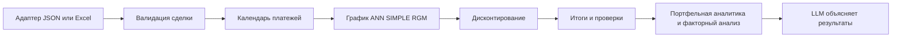

# Расчётный модуль денежных потоков

## Ответственность и интерфейс

Модуль строит будущие договорные платежи одной сделки и рассчитывает их приведённую стоимость. Прототип реализован на Python; `cpp/cashflows.hpp` предлагает C++17-интерфейс для переноса алгоритма. Заголовок проверяется компилятором, но реализации и проверки числовой точности C++ в этом спринте нет.

| Функция | Вход | Выход | Правило |
|---|---|---|---|
| validate | Deal, DiscountSpec | Diagnostic[] | Проверяет поля, ставки, даты, поддержку ACT/365F |
| build_payment_dates | Deal | Date[] | Привязка к первому дню платежа; дата погашения ровно один раз |
| build_schedule | Deal, PaymentType | Payment[] | Ставка сделки, HALF_UP, последний платёж закрывает остаток |
| discount | Deal, DiscountSpec, Payment[] | ValuedPayment[] | Отдельная ставка дисконтирования, PERIOD_SIMPLE_CHAIN |
| summarize | Deal, ValuedPayment[] | Summary | Номинальные суммы, PV, разница с текущим долгом |
| check | Deal, ValuedPayment[] | CheckResult | Согласование строк, погашение тела и финальный остаток |

Изменение DiscountSpec не перестраивает договорные платежи. Изменение Deal требует нового графика. Для портфеля оркестратор вызывает ядро по каждой сделке; это не задача данной библиотеки.

## Передача данных и ошибки

JSON-контракт версии 1.0: `contracts/request.schema.json`, `contracts/response.schema.json`. Запрос содержит валюту RUB, дату оценки, остаток, кредитную ставку, первую/последнюю даты, частоту, ACT/365F и отдельную дисконтную ставку. Ответ содержит параметры, метод, результаты для выбранных типов и источники. Деньги передаются строками с двумя знаками, ставки — долями единицы ("0.075" означает 7,5%).

Внутри C++ деньги хранятся в `int64_t` копейках. Максимум входа 15 цифр до точки меньше предела int64 после умножения на 100; каждый промежуточный результат и итог проверяются на переполнение. Ставки, DF и PV требуют десятичной арифметики с минимум 40 значащими цифрами. Конкретная decimal-библиотека выбирается совместно с командой, поддерживающей C++: в этом спринте зависимость не навязывается. Использование double для денежного округления не обеспечивает совпадение с эталоном.

`validate` возвращает коды `INVALID_FIELD`, `INVALID_DATE_ORDER`, `UNSUPPORTED_CONVENTION`, `UNSUPPORTED_CURRENCY`, `HORIZON_LIMIT`, `NEGATIVE_RATE`. Расчётные функции проверяют входы и выбрасывают `invalid_argument` при недопустимом запросе, `overflow_error` при переполнении. ANN отклоняется, если регулярный платёж не покрывает проценты: отрицательная амортизация в версии 1 не поддерживается. JSON-адаптер преобразует ошибки в структурированный ответ; частичные результаты не выдаются как успешный расчёт.

JSON Schema проверяет форму данных; сравнение дат, предел 1200 платежей, равенство ключей ответа payment_types и бухгалтерские равенства проверяет ядро. Python-парсер дополнительно отклоняет неизвестные поля, NaN/Infinity, отрицательные ставки и некорректную точность денег.

## Границы между командами

| Компонент | Ответственность |
|---|---|
| Расчётное ядро | Календарь, начисление процентов, тело, остаток, DF, PV, итоги, локальные проверки |
| Адаптеры и данные | Чтение Excel/JSON, преобразование полей, metadata, идентификаторы, источники и версии |
| Риск-команда | Рыночные кривые, PD/LGD/EAD, сценарии дефолта, правила Economic Capital |
| Аналитическая команда | Агрегация портфеля, сравнение периодов, выявление факторов и взаимодействий |
| LLM-компонент | Интерпретация проверенных чисел с ссылками на расчёт |

Ядро не включает UI, хранилище, API-сервер, Excel-автоматизацию, калибровку рыночной кривой, ML или LLM. Поддержка бизнес-календаря, плавающих ставок, комиссий и досрочного погашения требует отдельного расширения контракта.

## Каталог тестов для переноса в C++

| Проверка | Ожидаемый результат |
|---|---|
| Все 334 ANN-платежа | Точное совпадение денег и дат исходного Excel |
| Все SIMPLE/RGM и DF/PV | Совпадение денег до копейки; PV ≤ 1e−7 RUB; DF ≤ 1e−12 |
| Первый ANN | 22 дня; проценты 16482.09; тело 9521.11; платёж 26003.20 |
| Последний ANN | 24 дня; проценты 127.62; платёж 26005.46; остаток 0.00 |
| SIMPLE | Тело нулевое до финальной даты; последний платёж 3664018.35 |
| RGM | Тело 10916.28; последний остаток тела 10916.65 |
| Нулевая кредитная ставка | Проценты 0; сумма тела совпадает с долгом |
| Нулевая дисконтная ставка | DF=1; PV равна сумме платежей |
| Високосный февраль | 29 фактических дней, знаменатель 365 |
| Конец месяца | 31 января → 28 февраля → 31 марта без накопления сдвига |
| Короткий финальный период | Дата погашения включена один раз, фактические дни |
| HALF_UP | 0.005 RUB округляется до 0.01 RUB |
| Маленький долг | Сумма тела точная, отрицательных остатков нет |
| ANN-платёж меньше процентов | Явная ошибка неподдерживаемой отрицательной амортизации |
| Изменение discount rate | Потоки не меняются; PV снижается при росте ставки |
| Плохие даты/ставки/типы | Явная ошибка без успешного частичного результата |
| Переполнение int64/decimal | Контролируемая ошибка, отсутствие UB |
| Перестановка/пропуск/дублирование дат | Ошибка календаря и согласования |
| JSON round-trip | Деньги не теряют копейки; версия и все поля сохраняются |

## Критерий готовности C++-реализации в следующем этапе

Реализовать сигнатуры, выбрать decimal-библиотеку, пройти числовые эталоны Python и тесты переполнения, согласовать JSON-адаптер и границы ответственности с другими командами. В рамках первого спринта подготовлены предложение интерфейса и проверяемый расчётный эталон.
