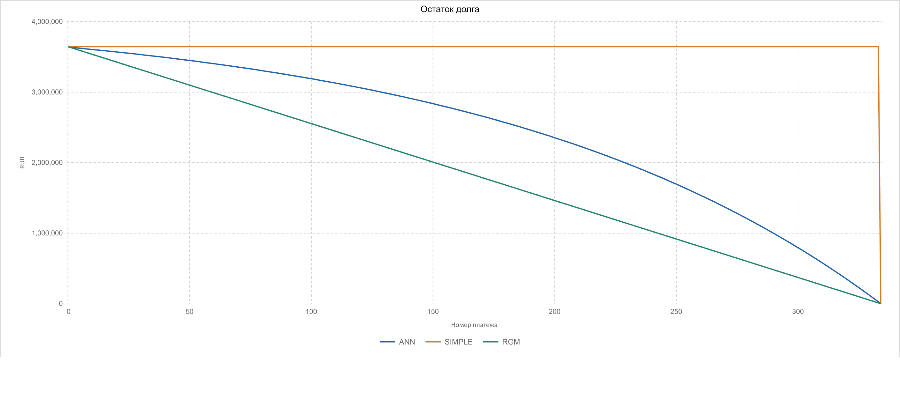
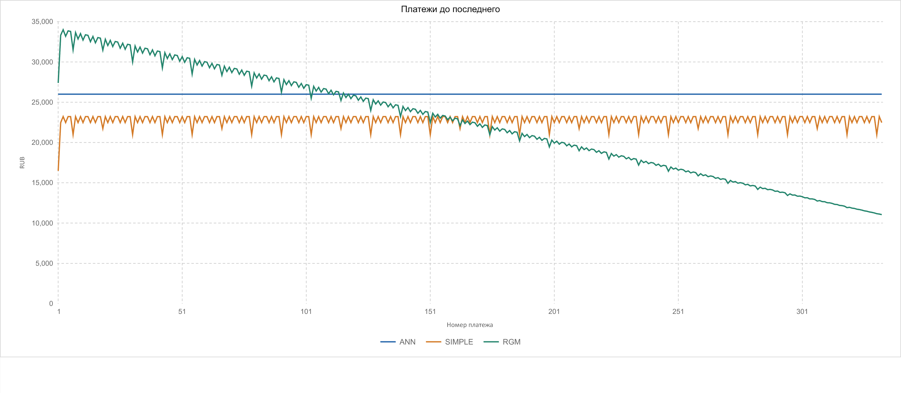
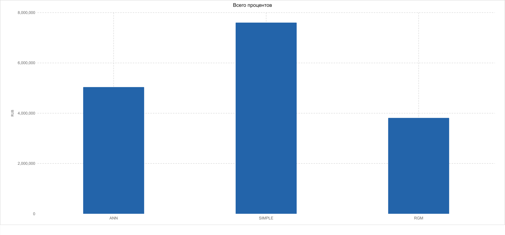

# Денежные потоки сделки и результаты первого спринта

## Результат

Подготовлен воспроизводимый прототип ANN, SIMPLE и RGM. Расчёт выполняется на Python с Decimal; новый Excel показывает формулы. Все суммы ниже относятся к будущим потокам после даты оценки. Это расчёт одной сделки, который станет основой последующих этапов факторного анализа.

## Исходные данные и допущения

Долг 3 646 037,89 RUB на 2022-08-31; кредитная ставка 7.500% годовых. Первый платёж 2022-09-22, погашение 2050-06-15, интервал 1 месяц(ев). Дата открытия 22.06.2020 сохранена в исходном файле справочно: прототип начинается с известного остатка, прошлые выплаты не восстанавливаются.

Дисконтная ставка задаётся отдельно: 7.500% годовых в базовом примере. Это учебное допущение; рыночная кривая не предоставлена. ACT/365F делит фактическое число дней на 365 и в високосном году. Выходные не сдвигают даты. Комиссии, страховки, досрочные погашения, дефолты и проценты, накопленные до даты оценки, не заданы.

Проценты и погашение тела округляются HALF_UP до двух знаков. Коэффициенты дисконтирования и PV вычисляются с 40 значащими цифрами без промежуточного округления; в JSON и CSV DF/ставки отображаются с 18 знаками, PV с 8. В Excel применяется ROUND(x,2).

## Разбор исходного ANN

В исходной книге лист «График платежей», H9:I20, содержит параметры; B10:F609 — формулы графика (334 заполненных платежа). Лист «Расчет платежа» вычисляет коэффициенты на фактических датах. ANN использует эти коэффициенты, а не ставку 7,5% / 12 для каждого интервала в выбранном режиме «Факт / 365».

Для периода i: d_i = date_i − date_(i−1); q_i = r_credit × d_i / 365; D_0 = 1; D_i = D_(i−1) / (1 + q_i). Регулярный аннуитет A = ROUND(P_0 / ΣD_i, 2). В исходном примере ΣD_i = 140,2149596068776 и A = 26 003,20 RUB.

Проценты I_i = ROUND(B_(i−1) × q_i, 2); платёж C_i = MIN(A, B_(i−1) + I_i); погашение тела T_i = C_i − I_i; остаток B_i = B_(i−1) − T_i. В последнюю дату C_n = B_(n−1) + I_n: это закрывает копеечный остаток после округления.

Первый интервал 31.08.2022 → 22.09.2022 составляет 22 дня: I_1 = ROUND(3 646 037,89 × 0,075 × 22 / 365, 2) = 16 482,09; T_1 = 26 003,20 − 16 482,09 = 9 521,11; B_1 = 3 636 516,78 RUB.

Второй интервал составляет 30 дней: I_2 = ROUND(3 636 516,78 × 0,075 × 30 / 365, 2) = 22 416,88; T_2 = 3 586,32; B_2 = 3 632 930,46 RUB.

Последний интервал 22.05.2050 → 15.06.2050 составляет 24 дня: I_n = ROUND(25 877,84 × 0,075 × 24 / 365, 2) = 127,62; C_n = 25 877,84 + 127,62 = 26 005,46; конечный остаток 0,00 RUB.

| № | Дата | Дней | Платёж RUB | Проценты RUB | Тело RUB | Остаток RUB |
|---:|---|---:|---:|---:|---:|---:|
| 1 | 2022-09-22 | 22 | 26 003,20 | 16 482,09 | 9 521,11 | 3 636 516,78 |
| 2 | 2022-10-22 | 30 | 26 003,20 | 22 416,88 | 3 586,32 | 3 632 930,46 |
| 3 | 2022-11-22 | 31 | 26 003,20 | 23 141,27 | 2 861,93 | 3 630 068,53 |
| 19 | 2024-03-22 | 29 | 26 003,20 | 21 324,60 | 4 678,60 | 3 573 933,11 |
| 333 | 2050-05-22 | 30 | 26 003,20 | 317,86 | 25 685,34 | 25 877,84 |
| 334 | 2050-06-15 | 24 | 26 005,46 | 127,62 | 25 877,84 | 0,00 |

Интервал 22.02.2024 → 22.03.2024 содержит 29 дней; база остаётся 365. Даты следующих платежей привязаны к первоначальному дню месяца, последний короткий период заканчивается точно в дату погашения.

## SIMPLE и RGM

SIMPLE: каждый период оплачиваются проценты на неизменный долг; всё тело 3 646 037,89 RUB возвращается в последний день. Последний платёж 3 664 018,35 RUB включает 17 980,46 RUB процентов за 24 дня.

RGM: регулярное погашение тела ROUND(3 646 037,89 / 334, 2) = 10 916,28 RUB. Последний платёж закрывает 10 916,65 RUB тела и 53,84 RUB процентов. При маленьком долге погашение ограничивается текущим остатком. Общая тенденция процентной части снижается, но фактическое число дней вызывает колебания между соседними платежами.

## Сравнение

| Тип | Платежей | Всего выплат RUB | Проценты RUB | Тело RUB | PV RUB | PV минус долг RUB | Конечный остаток RUB |
|---|---:|---:|---:|---:|---:|---:|---:|
| ANN | 334 | 8 685 071,06 | 5 039 033,17 | 3 646 037,89 | 3 646 037,92 | 0.03023904 | 0,00 |
| SIMPLE | 334 | 11 250 274,43 | 7 604 236,54 | 3 646 037,89 | 3 646 037,88 | -0.00522707 | 0,00 |
| RGM | 334 | 7 459 022,01 | 3 812 984,12 | 3 646 037,89 | 3 646 037,90 | 0.00531659 | 0,00 |

На графике регулярных платежей последний платёж исключён для читаемости. Крупный возврат тела SIMPLE показан числом в сравнительной таблице и в полном CSV/Excel.

## Дисконтирование и интерпретация

F_0 = 1; F_i = F_(i−1) / (1 + r_discount × d_i / 365). PV_i = C_i × F_i; PV_future = ΣPV_i. PV процентов и тела считается отдельно и суммируется. PERIOD_SIMPLE_CHAIN — последовательное дисконтирование по простой ставке интервала; оно отличается от (1 + r)^(−days/365) с эффективной годовой ставкой и от обычного XNPV.

При r_discount = r_credit без округления C_i = B_(i−1)(1+q_i) − B_i. После умножения на F_i сумма телескопируется: ΣC_iF_i = B_0 − B_nF_n. При B_n=0 PV равна начальному долгу независимо от способа погашения. Копеечное округление процентов и платежей объясняет небольшие остаточные различия в данном примере.

Следовательно, различия номинальных процентов между графиками не доказывают разницу приведённой стоимости при этой дисконтной ставке. Для рыночной оценки нужна независимо обоснованная ставка или кривая. PV минус текущий долг — диагностическое сравнение с балансовым остатком; полный NPV от выдачи требует первоначального исходящего потока и всех прочих потоков. Economic Capital не рассчитывается на этом этапе.

## Проверки и воспроизводимость

Сверка источников: 14737 сравнений; 0 расхождений. Сопоставлены 334 платежа исходного ANN и 1002 строки ANN/SIMPLE/RGM второго файла. Сверяются сохранённые значения источников; исходные книги не пересчитывались в установленном Excel.

Для каждой строки проверены непрерывность долга, сумма процентов и тела, движение остатка и разделение PV. Для каждого графика сумма тела равна начальному долгу и конечный остаток нулевой. Допуски сверки: деньги 0,00 RUB; PV 0,00000010 RUB; DF и ставки периода 10^−12.

Автотесты дополнительно проверяют нулевую ставку, ACT/365F в високосном году, календарь конца месяца, короткий финальный период, половинное округление, маленький долг, недопустимые входы и независимость ставки дисконтирования. Тесты сверки специально меняют сумму и дату, чтобы убедиться в обнаружении ошибок.

Повторение расчёта: `python -m unittest discover -s tests -v`, затем `python -m sprint1.run`. Вход — `contracts/request.example.json`. Для другой сделки используются `--input` и `--skip-reference`; сверка с эталоном явно помечается пропущенной. CSV и JSON содержат полный график; `verification.json` и `workbook_verification.json` сохраняют результаты проверок. Команды сборки Excel и проверки интерфейса приведены в README.

## Контракт и границы модуля

Запрос передаёт версию, параметры сделки, отдельную ставку дисконтирования и список типов платежей. Ответ возвращает полный график, составляющие PV, итоги, допущения и источники. Деньги и ставки — десятичные строки; даты — ISO 8601. JSON Schema лежат в `contracts/`, полный ответ — `calculation.json`.

Предложение C++: validate → build_payment_dates → build_schedule → discount → summarize → check. Ядро не читает Excel, не обращается к LLM, не выполняет факторный анализ или расчёт EC. Адаптеры занимаются JSON/Excel, командная аналитика — риск-параметрами, факторным разложением и объяснениями. Подробности: `docs/cpp-module.md`; типы и сигнатуры: `cpp/cashflows.hpp`. Это проект интерфейса; исполняемый прототип написан на Python.

## Выполнение задач спринта

| Задача | Подготовленные материалы | Критерий |
|---|---|---|
| Разобрать ANN | Формулы и примеры выше; сверка каждой строки | Значения источника объясняются и воспроизводятся |
| Рассчитать SIMPLE и RGM | CSV, JSON, Excel; расчётный код | Сумма тела равна долгу, конечный остаток нулевой |
| Дисконтировать потоки | Метод, DF/PV каждой строки, сравнение | Дата, ставка, метод и округление зафиксированы |
| Описать входы и выходы | Схемы запроса/ответа и примеры JSON | Поля и ограничения имеют явные определения |
| Предложить границы C++ | Документ архитектуры, header, каталог тестов | Ответственность ядра и соседних команд разделена |

## Ограничения и следующий этап

Версия 1 поддерживает RUB, фиксированную неотрицательную номинальную ставку, ACT/365F, от 1 до 1200 платежей и частоту 1–120 месяцев. ANN отклоняется, если регулярный платёж меньше процентов: отрицательная амортизация не поддерживается. Календарь для данной сделки фиксируется входными датами; изменение календаря требует нового запуска сборки материалов. Входные денежные суммы задаются с двумя знаками и максимум 15 цифрами до точки; десятичные строки ставок ограничены 32 символами.

Для универсального факторного анализа потребуются наблюдения за несколькими периодами, портфель и дополнительные факторы. По одной сделке нельзя подтвердить устойчивость ML-объяснений изменения NPV. В следующем этапе можно добавить рыночную кривую, портфельную агрегацию, риск-параметры и затем факторное разложение с LLM-интерпретацией.

## Источники

- `annuity-payment-schedule.xlsx`; SHA-256 `06f90aee9b2b6edf209f6a64ce662115b4a11ab4ca7ae285f380d817d3402ceb`.
- `payment_schedules_discounted.xlsx`; SHA-256 `e730baf1449f4d39be0b2474af017afdc1feeb1099238302c8634763f7987eb8`.
- Документ «Постановка задачи Часть 3 факторный анализ Economic Capital» и изображения «что есть», «что надо сделать»: общий контекст и пять критериев текущего спринта.
